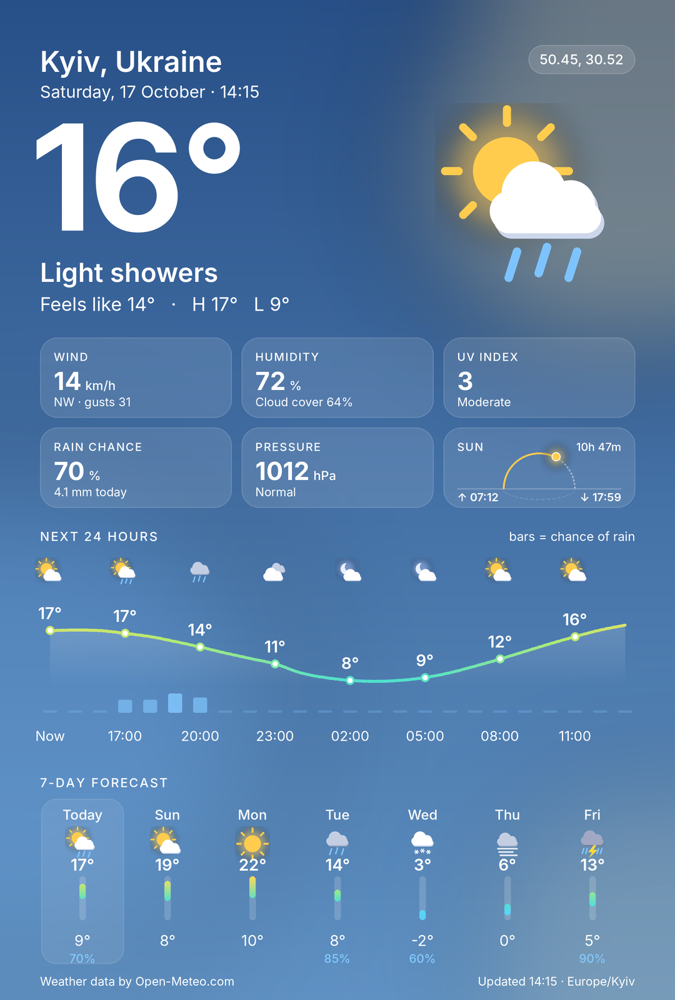
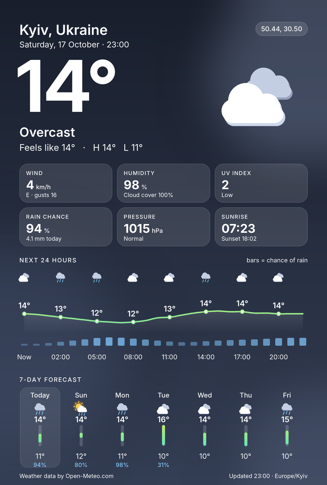
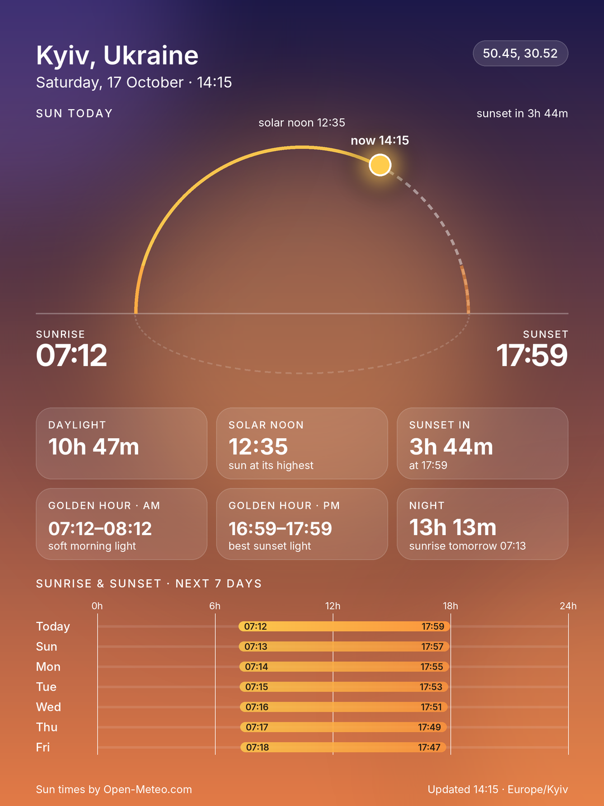

<h1 align="center">telegram-weather-bot</h1>

<p align="center">
  Share your location once. Get a fresh, beautifully rendered weather infographic any time.
</p>

<p align="center">
  
  &nbsp;
  
  &nbsp;
  
</p>

## What it does

1. `/start` – the bot asks for your location with Telegram's **📍 Share my location** button
   (or you can type a city name, handy on Telegram Desktop).
2. The location is saved per user as slot 1 and turned into a place name. Save more with
   `/add` (speed dial: up to 10 slots, one of them the default).
3. You get a PNG card with the current conditions, a 24-hour temperature curve with rain
   probability, a sun-path tile and a 7-day outlook, themed by weather and time of day.
   The caption repeats the key numbers as formatted text with emoji.
4. `/weather` – or the **🔄 Refresh** button under the picture – re-renders a fresh card.
   Refresh replaces the photo in place, so the chat stays tidy.
5. `/sun` – a dedicated sunrise/sunset card: sun position on its arc, daylight length and its
   change versus yesterday, solar noon, golden hours, and a 7-day sunrise/sunset strip.
6. `/schedule` – automatic cards without asking: every morning, morning & evening, three times
   a day, hourly 09–21, every 3 hours, or your own times; every day or weekdays only. Times are
   in your default location's time zone.

Everything is drawn with Pillow; no browser, no image assets, no API keys.

### Commands

| Command | What it does |
| --- | --- |
| `/start` | Welcome + first location |
| `/weather` (`/now`, `/w`) | Weather card for your default location |
| `/weather 2` · `/weather home` | Weather card for slot 2, or for the slot called "home" |
| `/sun` (`/sunset`, `/sunrise`) | Sunrise & sunset card; takes the same slot argument |
| `/locations` (`/list`) | Your slots, with buttons to fetch, make default or remove |
| `/add [name]` | Save another location (share it or type a city), optionally naming the slot |
| `/default N` · `/rename N name` · `/remove N` | Manage slots by number |
| `/schedule` | Menu of notification presets; `/schedule 7:30 18:00` sets custom times, `/schedule off` stops |
| `/units` | Toggle °C / km/h ↔ °F / mph (also a button under each card) |
| `/forget` | Erase everything stored about you (asks to confirm) |
| `/help` | Command list |
| *any text* | One-off card for that city; your slots stay unchanged |

Buttons under a weather card: **🔄 Refresh**, **°C/°F**, **🌅 Sun card**, **📍 My locations**.
Under a sun card: **🔄 Refresh**, **🌤 Weather card**, **📍 My locations**. All of them replace
the current photo in place.

## Run it

### Docker Compose (recommended)

```bash
cp .env.example .env            # put your bot token in TG_BOT_TOKEN
docker compose up -d
```

State (saved locations, unit preferences) lives in the `weather-bot-data` volume.
Set `WEATHER_BOT_IMAGE` to use a different image tag.

### Locally

Requires Python 3.11+ and [Poetry](https://python-poetry.org/) 2.x.

```bash
poetry install
cp .env.example .env            # add TG_BOT_TOKEN
poetry run weather-bot          # or: poetry run python -m weather_bot
```

### Configuration

| Variable | Default | Meaning |
| --- | --- | --- |
| `TG_BOT_TOKEN` | – | Bot token from [@BotFather](https://t.me/BotFather). Required. |
| `DATA_DIR` | `./data` (`/data` in Docker) | Directory for the persistence file |
| `HTTP_TIMEOUT` | `15` | Seconds to wait for weather / geocoding requests |
| `FORECAST_CACHE_TTL` | `3600` | Seconds a forecast is reused per place (~1 km grid) and units before Open-Meteo is called again |
| `USER_AGENT` | `telegram-weather-bot/1.0 (+repo url)` | Sent to Open-Meteo and Nominatim. Change it if you fork. |
| `BOT_NAME` | `Weather Card Bot` | Bot name, applied on startup through the Bot API |
| `BOT_SHORT_DESCRIPTION` | *(see `identity.py`)* | "About" text shown in the profile |
| `BOT_DESCRIPTION` | *(see `identity.py`)* | Text shown before the chat starts |

### Forecast cache

Every card, caption, refresh button and scheduled send goes through an in-memory cache keyed by
rounded coordinates and units. A place is fetched from Open-Meteo at most once per hour (see
`FORECAST_CACHE_TTL`), concurrent requests for the same place share one call, and if the API is
down a result up to six hours old is served instead of an error. The free Open-Meteo tier allows
10 000 calls a day; with the cache, even hourly schedules for hundreds of users stay far below it.

### Scheduled cards

A background task ticks every 30 seconds, converts the current time into each user's schedule
time zone and sends the weather card for their default slot when a configured time comes up
(once per slot per day, with a 10-minute grace window if the bot was briefly down). Schedules
are stored with the rest of the user state, so they survive restarts. A user who blocks the bot
or deletes all locations has the schedule removed automatically.

On every start the bot syncs its name, descriptions and command list with Telegram, so the
profile stays in step with the code. The profile picture is the one thing the Bot API cannot
set: upload `docs/avatar.png` with `/setuserpic` in @BotFather (regenerate it with
`python scripts/avatar.py`).

### Deployment pipeline

`.github/workflows/docker-ci.yml` runs on every push to `main`: it builds a multi-arch image,
pushes it to Docker Hub as `<DOCKERHUB_USERNAME>/telegram-weather-bot:latest`, copies
`docker-compose.yaml` to the server over SCP and runs `docker compose up -d` there.
Secrets it needs: `DOCKERHUB_USERNAME`, `DOCKERHUB_PASSWORD`, `SSH_HOST`, `SSH_USERNAME`,
`SSH_KEY`, `SSH_PORT`, `TG_BOT_TOKEN`, and `TELEGRAM_NOTIFY_CHAT` / `TELEGRAM_NOTIFY_TOKEN`
for the status messages.

## Usage telemetry

The bot keeps its own usage counters in `DATA_DIR/telemetry.sqlite3` (mode 0600): per Telegram
user id (plus username and language) how often each command/button was used, and for which city
cards were requested. Coordinates, message text and chat ids are not stored. Set
`ADMIN_USER_IDS` and send `/stats`: an infographic card (totals, top cities, users, actions) with a 14-day activity chart, followed by the same as text.
Every event is also appended to a raw log (time, user id, command/button, city; city only for
cards), so any question can be answered later with SQL (`event_log` table), and `/export`
(admin only) sends it as CSV (newest 200 000 rows). The log is never pruned automatically.
`/help` tells users that this is collected. Delete the file to reset it.

## Development

```bash
poetry run pytest                 # unit tests (parsing, geocoding, rendering, handlers)
poetry run ruff check . && poetry run ruff format --check .
poetry run python scripts/preview.py                                  # live card for Kyiv -> preview.png
poetry run python scripts/preview.py 51.5 -0.12 London --units imperial
poetry run python scripts/preview.py --fixture tests/fixtures/forecast.json
poetry run python scripts/preview.py --sun                                    # sun card
```

`scripts/preview.py` is the fastest way to iterate on the design: it renders a card without
Telegram. `tests/make_fixture.py` regenerates the deterministic sample forecast used by tests.

### Project layout

```
src/weather_bot/
├── main.py          entry point, wires PTB Application + persistence
├── bot.py           Telegram handlers (slots, /weather, /sun, inline buttons)
├── locations.py     per-user saved locations ("speed dial") stored in user_data
├── caption.py       emoji captions for both cards
├── identity.py      syncs bot name / descriptions / commands with Telegram
├── sun.py           sunrise / sunset arithmetic
├── schedule.py      notification presets, custom times, due-slot logic
├── scheduler.py     background task that sends scheduled cards
├── runtime.py       process-wide HTTP client (kept out of persisted state)
├── config.py        environment settings
├── weather.py       Open-Meteo client, Forecast model, WMO code mapping
├── geocode.py       Nominatim reverse geocoding, Open-Meteo city search
├── render/
│   ├── card.py      layout + composition of the weather card
│   ├── sun_card.py  the sunrise / sunset card
│   ├── sunpath.py   sun-arc graphic shared by both cards
│   ├── icons.py     procedurally drawn weather icons
│   ├── theme.py     palettes per condition/day-night, temperature colour ramp
│   └── fonts.py     bundled Inter font loader
└── assets/fonts/    Inter (SIL OFL 1.1)
```

### How a card is built

- Rendered at 2× (2160×3200) and downsampled with Lanczos, so text, curves and icons are
  antialiased.
- Background gradient and glow blobs come from the theme for the current condition and
  day/night flag.
- Hourly curve is a Catmull-Rom spline through the next 24 hourly temperatures, coloured by
  temperature; the bars beneath are precipitation probability.
- Daily columns show max/min with a vertical range bar positioned against the week's range.

## Data sources & credits

- Weather: [Open-Meteo](https://open-meteo.com/) (free for non-commercial use, no key).
- Reverse geocoding: [Nominatim / OpenStreetMap](https://nominatim.org/) – data © OpenStreetMap
  contributors, ODbL. The bot sends a single request per location setup and identifies itself
  with `USER_AGENT`, as their usage policy requires.
- City search: [Open-Meteo Geocoding API](https://open-meteo.com/en/docs/geocoding-api).
- Typeface: [Inter](https://github.com/rsms/inter) by Rasmus Andersson, SIL Open Font License.

See [TODO.md](TODO.md) for the performance, security and robustness review with prioritised next steps.

## License

MIT
